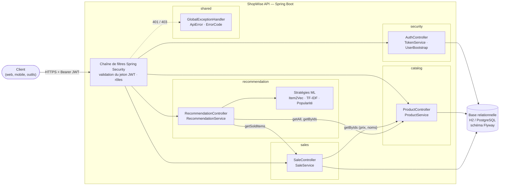
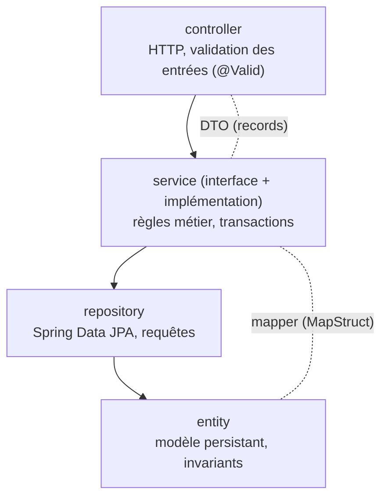
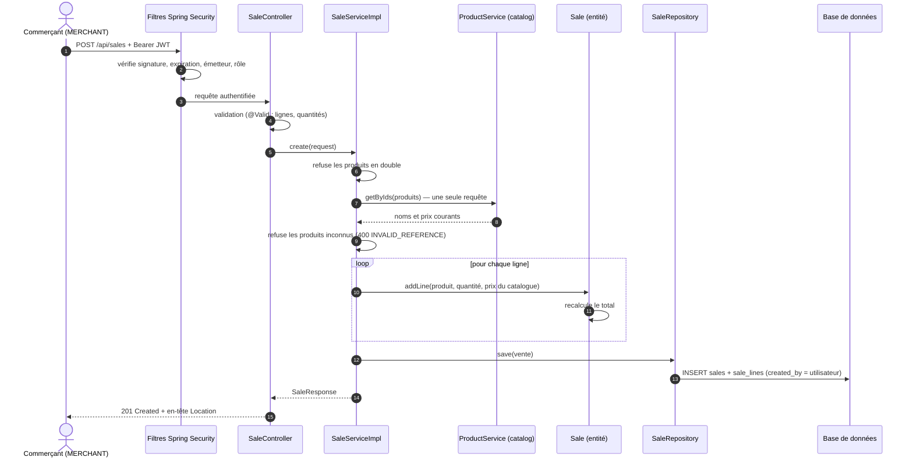
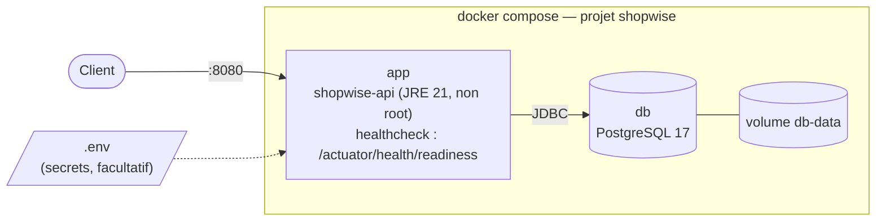
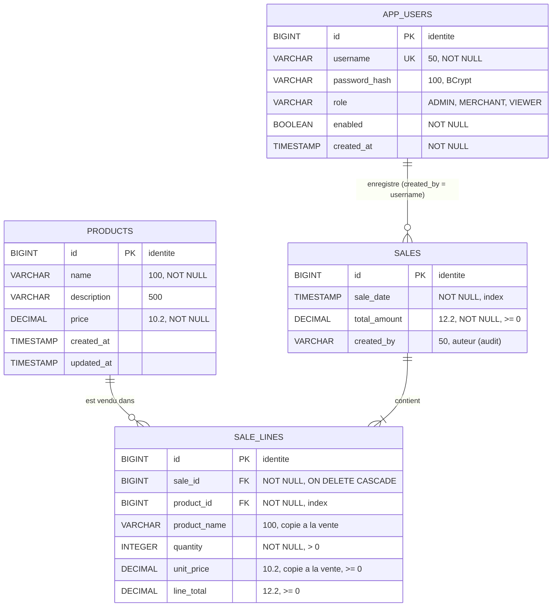
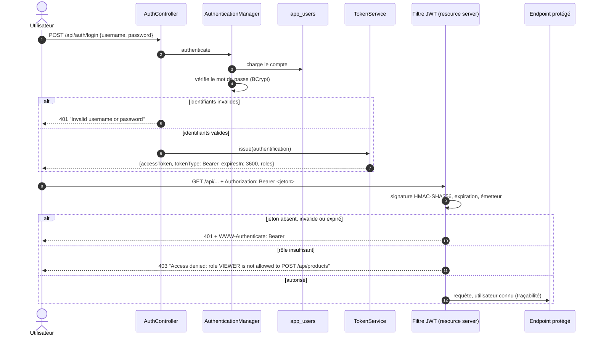
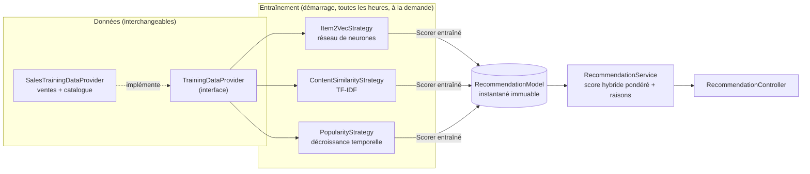
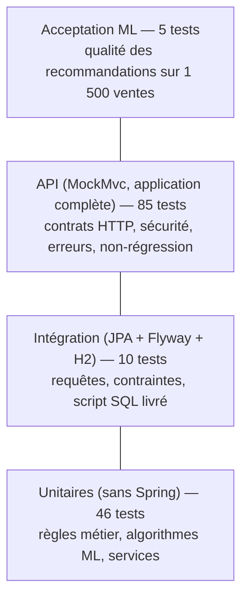

# ShopWise — API de gestion pour commerces de proximité

Backend **Java 21 / Spring Boot 4** de la plateforme ShopWise : catalogue produits, enregistrement des ventes, API sécurisée par jeton JWT et module de recommandations à base d'apprentissage automatique.

> Étude de cas « ShopWise — Conception avancée » — RNCP 35419 *Expert en Ingénierie du Logiciel*, bloc *Conception avancée de l'architecture du logiciel*. Seul le backend est concerné (pas de frontend à réaliser).

| | |
|---|---|
| **Stack** | Java 21, Spring Boot 4.0.1 (Spring MVC, Data JPA, Security 7, OAuth2 Resource Server, Actuator), Hibernate 7, Flyway 11, MapStruct, H2 / PostgreSQL 17 |
| **Qualité** | 146 tests (unitaires, intégration, API, non-régression, acceptation ML) — couverture vérifiée à chaque build par JaCoCo |
| **Livraison** | Image Docker multi-étapes + `docker-compose` (API + PostgreSQL) |

## Sommaire

1. [Démarrage rapide](#1-démarrage-rapide)
2. [Structure du dépôt et livrables](#2-structure-du-dépôt-et-livrables)
3. [Reprise de l'existant](#3-reprise-de-lexistant)
4. [Q1 — Architecture cible](#4-q1--architecture-cible)
5. [Q2 — Module Ventes et modèle de données](#5-q2--module-ventes-et-modèle-de-données)
6. [Q3 — Sécurisation de l'API et normalisation des erreurs](#6-q3--sécurisation-de-lapi-et-normalisation-des-erreurs)
7. [Q4 — Module de recommandations (machine learning)](#7-q4--module-de-recommandations-machine-learning)
8. [Q5 — Stratégie de tests](#8-q5--stratégie-de-tests)
9. [Référence de l'API](#9-référence-de-lapi)
10. [Limites connues et pistes d'évolution](#10-limites-connues-et-pistes-dévolution)

---

## 1. Démarrage rapide

### Avec Docker (API + PostgreSQL, données de démonstration)

```bash
docker compose up --build
```

L'API est disponible sur <http://localhost:8080> dès que le conteneur est `healthy` (comptes créés, données chargées, modèle de recommandation entraîné). Le profil `demo` charge l'épicerie « Chez Marie » : 24 produits et 1 500 ventes sur 6 mois.

```bash
docker compose down        # arrêter
docker compose down -v     # arrêter et effacer la base
```

Les secrets (clé JWT, mots de passe) se configurent dans un fichier `.env` (modèle : [`.env.example`](.env.example)). Sans `.env`, des valeurs **de démonstration** sont utilisées.

### Sans Docker (H2 en mémoire)

Prérequis : JDK 21. Maven n'est pas nécessaire (wrapper fourni).

```bash
./mvnw spring-boot:run                                        # catalogue initial (4 produits)
./mvnw spring-boot:run -Dspring-boot.run.profiles=demo        # avec les données de démonstration
```

### Comptes et premier appel

| Compte | Mot de passe (démo) | Rôle | Droits |
|---|---|---|---|
| `admin` | `admin123` | ADMIN | tout, dont la gestion du catalogue |
| `merchant` | `merchant123` | MERCHANT | consulter, enregistrer des ventes |
| `viewer` | `viewer123` | VIEWER | consulter uniquement |

```bash
# 1. Obtenir un jeton
TOKEN=$(curl -s -X POST http://localhost:8080/api/auth/login \
  -H "Content-Type: application/json" \
  -d '{"username":"merchant","password":"merchant123"}' | jq -r .accessToken)

# 2. Enregistrer une vente (le prix et le total sont calculés par le serveur)
curl -s -X POST http://localhost:8080/api/sales -H "Authorization: Bearer $TOKEN" \
  -H "Content-Type: application/json" \
  -d '{"lines":[{"productId":11,"quantity":2},{"productId":12,"quantity":1}]}'

# 3. Recommandations pour un produit
curl -s http://localhost:8080/api/recommendations/products/11 -H "Authorization: Bearer $TOKEN"
```

### Lancer les tests

```bash
./mvnw verify                                  # tous les tests + rapport et seuil de couverture
./mvnw test -Dgroups=non-regression            # uniquement la non-régression du catalogue
./mvnw test -Dgroups=ml                        # uniquement l'acceptation du modèle de recommandation
```

Rapport de couverture : `target/site/jacoco/index.html` (copie livrée dans [`couverture/backend`](couverture/backend/index.html)).

---

## 2. Structure du dépôt et livrables

```
.
├── bdd/
│   ├── schema base de données.pdf   ← schéma de la base (livrable)
│   ├── script.sql                   ← script complet de la base (livrable, généré depuis les migrations)
│   ├── schema.mmd                   ← source Mermaid du schéma
│   ├── generate-script.ps1          ← régénère script.sql
│   └── generate-schema-pdf.ps1      ← régénère le PDF (Docker)
├── couverture/
│   ├── backend/                     ← rapport JaCoCo (livrable)
│   └── frontend/                    ← sans objet (pas de frontend), voir son readme
├── src/main/java/com/shopwise/app/
│   ├── catalog/                     ← module Catalogue (existant)
│   ├── sales/                       ← module Ventes
│   ├── security/                    ← authentification, autorisation, audit
│   ├── recommendation/              ← module Recommandations (ML)
│   ├── shared/                      ← erreurs normalisées, configuration transverse
│   └── demo/                        ← données de démonstration (profil demo)
├── src/main/resources/db/migration/ ← migrations Flyway V1 à V5 (source de vérité du schéma)
├── src/test/java/...                ← 146 tests
├── Dockerfile, docker-compose.yml, .env.example
└── readme.md
```

| Livrable demandé | Emplacement |
|---|---|
| `bdd/schema base de données.pdf` | [bdd/schema base de données.pdf](bdd/schema%20base%20de%20donn%C3%A9es.pdf) |
| `bdd/script.sql` | [bdd/script.sql](bdd/script.sql) |
| Code source mis à jour (fonctionnalités + tests) | `src/` |
| `couverture/[rapport backend]` | [couverture/backend](couverture/backend/index.html) |
| `couverture/[rapport frontend]` | [couverture/frontend](couverture/frontend/readme.md) — sans objet |
| Dockerfiles | [Dockerfile](Dockerfile), [docker-compose.yml](docker-compose.yml) |
| Diagrammes, justification de l'architecture, algorithme | ce document |

---

## 3. Reprise de l'existant

Avant toute évolution, le code fourni a été analysé puis **protégé par des tests de non-régression écrits sur la version d'origine** (30 tests sur le contrat HTTP de `/api/products`, le service et la persistance). Ces tests ont ensuite servi de filet à chaque étape : ils n'ont jamais été modifiés, à l'exception de l'ajout d'une ligne `@WithMockUser(roles = "ADMIN")` lors de la sécurisation de l'API.

L'historique Git retrace cette démarche commit par commit : import du code d'origine, filet de tests, puis une évolution par commit.

**Constats sur le code d'origine et suites données**

| Constat | Impact | Traitement |
|---|---|---|
| Le gestionnaire d'erreurs attrapait *toutes* les exceptions, y compris celles de Spring MVC | JSON mal formé, identifiant non numérique, méthode non supportée, route inconnue → **500** au lieu de 400 / 405 / 404 | Gestionnaire réécrit sur `ResponseEntityExceptionHandler` ; un test par cas |
| Trois formats d'erreur différents (texte brut, `Map`, texte) | Clients incapables de traiter les erreurs de façon uniforme | Format unique `ApiError` (US 6) |
| Cast `(FieldError)` sur toutes les erreurs de validation | `ClassCastException` sur une erreur globale | Gestion de `FieldError` et `ObjectError` |
| Schéma généré par Hibernate (`ddl-auto=create-drop`) + `data.sql` | Aucun contrôle des évolutions du schéma ; livrable `script.sql` impossible à garantir | Migrations **Flyway** versionnées, Hibernate en `validate` |
| Suppression physique d'un produit | Avec les ventes, un produit vendu ne pourrait plus être supprimé proprement (erreur 500) | Contrainte d'intégrité → **409 Conflict** explicite |
| `jakarta.transaction.Transactional` | Pas de transactions en lecture seule | `@Transactional` de Spring, `readOnly` sur les lectures |
| MapStruct sans politique de mapping | Un champ ajouté à l'entité pouvait être ignoré silencieusement | `ReportingPolicy.ERROR` : erreur de compilation |
| Console H2 ouverte, `show-sql` actif | Accès direct à la base hors API ; journaux bruyants | Console désactivée, `show-sql` désactivé |
| Pas de wrapper Maven, de README, de Docker, de couverture | Projet non reproductible par un tiers | Ajoutés |
---

## 4. Q1 — Architecture cible

### 4.1 Vue d'ensemble : un monolithe modulaire

L'application est un **monolithe modulaire** : un seul déployable, découpé en modules métier aux responsabilités et aux dépendances explicites. Chaque module expose une API publique (son service et ses DTO) et garde privés son modèle de persistance et ses requêtes.



**Responsabilités et interactions**

| Module | Responsabilité | Expose | Dépend de |
|---|---|---|---|
| `catalog` | Produits : création, mise à jour, consultation, suppression | `ProductService`, DTO produit | `shared` |
| `sales` | Enregistrement et consultation des ventes ; calcul des totaux | `SaleService`, DTO vente, `SoldItem` | `catalog` (service), `shared` |
| `recommendation` | Entraînement du modèle et calcul des recommandations | `RecommendationService` | `catalog`, `sales` (services uniquement), `shared` |
| `security` | Authentification JWT, autorisation par rôle, comptes, audit des auteurs | `SecurityFilterChain`, `/api/auth/*` | `shared` |
| `shared` | Format d'erreur unique, codes d'erreur, horloge injectable | `ApiError`, `ApiException`, `Clock` | — |
| `demo` | Jeu de démonstration (profil `demo` uniquement) | — | `catalog`, `sales` |

Les dépendances vont toujours **dans un seul sens** (`recommendation → sales → catalog → shared`), sans cycle. Les modules métier n'ont **aucune dépendance vers `security`** : l'auteur d'une vente est renseigné par l'audit JPA (`@CreatedBy`), et le contrôle d'accès est entièrement porté par la chaîne de filtres.

### 4.2 Organisation interne d'un module

Chaque module suit la même structure en couches, ce qui permet à un nouveau développeur de s'y retrouver immédiatement :



- Les **contrôleurs** ne contiennent aucune logique métier.
- Les **services** sont définis par une interface : ils sont remplaçables et faciles à simuler en test.
- Les **entités** protègent leurs invariants : une `Sale` ne peut être modifiée qu'à travers `addLine`, qui recalcule le total.
- Les **DTO** isolent le contrat HTTP du modèle de persistance : on peut faire évoluer l'un sans casser l'autre.

### 4.3 Exemple de flux : enregistrement d'une vente



### 4.4 Déploiement



Le conteneur `app` ne démarre qu'une fois la base saine, et n'est déclaré prêt (`healthy`) qu'après la migration du schéma, la création des comptes et l'entraînement du modèle.

### 4.5 Justification au regard des attributs de qualité

| Attribut | Choix | Pourquoi |
|---|---|---|
| **Évolutivité** | Monolithe modulaire à frontières explicites | Une startup avec une petite équipe n'a pas besoin de la complexité des microservices (réseau, déploiements multiples, cohérence distribuée). Des modules découplés pourront être extraits en services plus tard si la charge l'exige. |
| | Communication entre modules par interfaces de service | La ligne de vente référence le produit par identifiant, sans association JPA vers `Product` : le module Ventes ne dépend pas du modèle de persistance du catalogue. |
| | Stratégies de recommandation et sources de données interchangeables | Ajouter un algorithme ou une source de données = ajouter une classe (US 8). |
| | Schéma versionné par Flyway | Chaque évolution de la base est une migration rejouable, relue et testée ; indispensable à la reprise par un tiers. |
| | API sans état (JWT) | Plusieurs instances peuvent tourner derrière un répartiteur de charge sans session partagée (multi-commerces, montée en charge). |
| **Robustesse** | Validation systématique des entrées, invariants dans les entités | Une donnée invalide est refusée au plus tôt avec un message clair ; le total d'une vente ne peut pas être incohérent. |
| | Contraintes d'intégrité en base (clés étrangères, `CHECK`, unicité) | La base protège les données même en cas de bug applicatif. |
| | Gestion centralisée des erreurs, format unique | Plus aucune erreur technique n'apparaît en 500 ; aucun détail interne (SQL, trace) n'est renvoyé au client. |
| | Prix figé dans la ligne de vente | L'historique et le chiffre d'affaires restent justes quand le catalogue change. |
| | Modèle de recommandation immuable, remplacé atomiquement | Un réentraînement n'interrompt ni ne perturbe les requêtes en cours. |
| **Testabilité** | Services derrière des interfaces, injection par constructeur | Chaque service se teste seul avec des doubles (Mockito). |
| | Horloge (`Clock`) et graine aléatoire injectées | Les dates de vente et l'entraînement du modèle sont déterministes en test. |
| | Logique métier dans des objets simples (`Sale`, stratégies ML) | Testable sans Spring ni base de données, en millisecondes. |
| | `bdd/script.sql` vérifié par un test | Le livrable ne peut pas diverger du schéma réellement utilisé. |
| **Sécurité** | Voir [section 6](#6-q3--sécurisation-de-lapi-et-normalisation-des-erreurs) | Authentification forte, moindre privilège, aucun secret dans le code SQL. |
| **Maintenabilité** | Conventions uniformes, documentation dans le code, historique Git par étape | Facilite la reprise du projet par un tiers (C.15). |

**Choix écartés**

| Option | Raison du rejet |
|---|---|
| Microservices | Surcoût d'exploitation injustifié à ce stade ; le découpage modulaire garde la porte ouverte. |
| Sessions HTTP + cookies | Imposent une session partagée pour plusieurs instances, et une protection CSRF. |
| Fournisseur d'identité externe (Keycloak, Auth0) | Pertinent à terme (SSO, multi-commerces), mais disproportionné pour ce périmètre ; le *resource server* JWT utilisé permet de migrer sans changer les contrôleurs. |
| Association JPA `SaleLine → Product` | Couplerait le module Ventes au modèle de persistance du Catalogue. |
| `ddl-auto=update` | Évolutions de schéma implicites, non relues, non reproductibles. |
---

## 5. Q2 — Module Ventes et modèle de données

### 5.1 User stories couvertes

| US | Critère d'acceptation | Réalisation | Tests |
|---|---|---|---|
| US 1 | Une vente peut contenir plusieurs produits | `POST /api/sales` avec une liste de lignes (1 à 100) | `SaleApiTest`, `SaleTest` |
| | Le total est calculé automatiquement | Calcul par l'entité `Sale` à chaque ligne ajoutée ; prix et total envoyés par le client **ignorés** | `clientPriceIsIgnored`, `SaleTest` |
| | La vente est persistée et consultable | Réponse `201` + en-tête `Location` vers `/api/sales/{id}` | `createdSaleIsRetrievable` |
| US 2 | Toutes les ventes avec leurs informations principales | `GET /api/sales` : id, date, auteur, total, nombre de lignes et d'articles | `listSalesNewestFirst` |
| | Triées par date, plus récentes en premier | `ORDER BY sale_date DESC, id DESC` (l'identifiant départage les ventes simultanées) | idem, `SaleRepositoryTest` |
| US 3 | Lignes, quantités, prix unitaires et total | `GET /api/sales/{id}` | `saleDetail` |
| | Message d'erreur clair si la vente n'existe pas | `404 RESOURCE_NOT_FOUND`, « Sale not found » | `unknownSale` |

### 5.2 Schéma de la base de données



Le même diagramme est livré en PDF : [bdd/schema base de données.pdf](bdd/schema%20base%20de%20donn%C3%A9es.pdf). Le script SQL complet est [bdd/script.sql](bdd/script.sql).

### 5.3 Choix de modélisation

- **Prix et nom figés dans la ligne de vente.** `sale_lines.unit_price` et `product_name` sont copiés au moment de la vente. Modifier ensuite le catalogue ne réécrit ni l'historique ni le chiffre d'affaires (testé par `priceIsSnapshotAtSaleTime`).
- **Le serveur fait foi.** Le client n'envoie que `productId` et `quantity`. Les prix viennent du catalogue et le total est calculé côté serveur : un client malveillant ne peut pas fixer son prix.
- **Montants en `DECIMAL` et `BigDecimal`**, arrondis au centime : aucune erreur d'arrondi liée aux nombres à virgule flottante.
- **Intégrité garantie par la base** : un produit ne peut apparaître qu'une fois par vente (`UNIQUE (sale_id, product_id)`) ; quantités, prix et totaux sont contrôlés par des contraintes `CHECK` ; un produit déjà vendu ne peut pas être supprimé (clé étrangère sans cascade, traduite en `409 Conflict`).
- **Performance.**
  - La liste est produite par une **seule requête d'agrégation** (nombre de lignes et d'articles calculés en SQL) : pas de problème N+1.
  - Le détail charge la vente et ses lignes en une jointure (`@EntityGraph`).
  - Index sur `sales.sale_date` (tri de la liste) et sur `sale_lines.product_id` (recommandations, vérification avant suppression).
- **Traçabilité** : `sales.created_by` contient l'utilisateur authentifié qui a enregistré la vente (US 5).

### 5.4 Gestion du schéma

Le schéma est géré par **Flyway**. Les migrations de `src/main/resources/db/migration` sont la source de vérité :

| Version | Contenu |
|---|---|
| V1 | Table `products` (reprise à l'identique du schéma d'origine) |
| V2 | Catalogue initial (ancien `data.sql`) |
| V3 | Tables `sales` et `sale_lines` |
| V4 | Table `app_users` |
| V5 | Colonne `sales.created_by` |

Hibernate est en mode `validate` : l'application **refuse de démarrer** si les entités et le schéma divergent. Le livrable `bdd/script.sql` est généré par `bdd/generate-script.ps1` à partir des migrations, et le test `DatabaseScriptTest` vérifie qu'il les contient toutes et qu'il s'exécute sur une base vide. Le SQL est standard : les mêmes migrations sont appliquées sur H2 (développement, tests) et PostgreSQL 17 (Docker).

---

## 6. Q3 — Sécurisation de l'API et normalisation des erreurs

### 6.1 Opérations sensibles identifiées

| Opération | Risque si non protégée | Protection |
|---|---|---|
| Créer, modifier, supprimer un produit | Altération des prix, sabotage du catalogue | rôle `ADMIN` |
| Enregistrer une vente | Fausses ventes, chiffre d'affaires faussé | rôles `ADMIN`, `MERCHANT` |
| Consulter ventes, catalogue, recommandations | Fuite de données commerciales (chiffre d'affaires, habitudes d'achat) | authentification obligatoire |
| Réentraîner le modèle | Charge de calcul déclenchée à volonté | rôle `ADMIN` |
| Console H2, endpoints de supervision | Accès direct à la base, fuite de configuration | console désactivée ; seul `/actuator/health` est exposé |

### 6.2 Mécanisme retenu



- **Jeton JWT signé (HS256), sans état.** Le jeton porte le nom de l'utilisateur, ses rôles, l'émetteur et une expiration (1 h). Il est vérifié par le *resource server* OAuth2 de Spring Security : signature, algorithme, dates de validité et émetteur.
- **Mots de passe hachés avec BCrypt**, préfixés par l'algorithme (`{bcrypt}…`) pour pouvoir changer d'algorithme sans invalider les comptes.
- **Aucun secret dans le code SQL.** Les comptes initiaux sont créés au démarrage à partir de la configuration. La clé de signature et les mots de passe se fournissent par variables d'environnement (`SHOPWISE_JWT_SECRET`, `SHOPWISE_ADMIN_PASSWORD`…) ; une clé de moins de 256 bits empêche le démarrage.
- **Pas d'énumération de comptes** : un compte inconnu et un mauvais mot de passe donnent exactement la même réponse.
- **Traçabilité** : connexions réussies, échecs et refus d'accès sont journalisés ; l'auteur de chaque vente est enregistré.

### 6.3 Matrice d'autorisation

Centralisée dans `SecurityConfig` (un seul endroit à auditer) et vérifiée par `AuthorizationMatrixTest` (25 cas) :

| Opération | Sans jeton | VIEWER | MERCHANT | ADMIN |
|---|:---:|:---:|:---:|:---:|
| `POST /api/auth/login` | ✅ | ✅ | ✅ | ✅ |
| `GET /api/**` (catalogue, ventes, recommandations, `/auth/me`) | 401 | ✅ | ✅ | ✅ |
| `POST /api/sales` | 401 | 403 | ✅ | ✅ |
| `POST / PUT / DELETE /api/products/**` | 401 | 403 | 403 | ✅ |
| `POST /api/recommendations/model/retrain` | 401 | 403 | 403 | ✅ |
| `GET /actuator/health/**` | ✅ | ✅ | ✅ | ✅ |

### 6.4 Justification des choix

| Choix | Justification |
|---|---|
| JWT plutôt que session | API consommée par des applications web et mobiles ; aucun état serveur, donc plusieurs instances possibles sans session partagée. |
| HS256 (clé symétrique) plutôt que RS256 | Un seul service émet et vérifie les jetons. Avec plusieurs services vérificateurs, on passerait à RS256 (clé publique distribuée) sans changer les contrôleurs. |
| *Resource server* Spring Security plutôt qu'un filtre JWT maison | Implémentation éprouvée et maintenue ; aucun code cryptographique écrit à la main. |
| CSRF désactivé | Pas de cookie ni de session : le jeton est envoyé explicitement dans un en-tête, ce qui n'est pas exploitable par une attaque CSRF. |
| Autorisation par URL dans une configuration unique | La matrice des droits se lit en un seul endroit et se teste exhaustivement. |
| Rôles dans le jeton | Pas d'accès à la base à chaque requête. Contrepartie : un changement de rôle prend effet à l'expiration du jeton (1 h). |

### 6.5 Erreurs normalisées (US 6)

Toutes les erreurs, y compris les 401 et 403 levés dans les filtres de sécurité, ont le même format JSON :

```json
{
  "status": 400,
  "code": "VALIDATION_ERROR",
  "message": "Request validation failed",
  "path": "/api/sales",
  "timestamp": "2026-10-12T16:38:20.901Z",
  "errors": [ { "field": "lines[0].quantity", "message": "must be greater than 0" } ]
}
```

`code` est un identifiant stable sur lequel un client peut s'appuyer ; `message` est destiné à un humain ; `errors` n'apparaît que pour les erreurs de validation.

| HTTP | `code` | Cas |
|---|---|---|
| 400 | `VALIDATION_ERROR` | champ invalide, vente vide, produit en double |
| 400 | `MALFORMED_REQUEST` | corps JSON illisible |
| 400 | `INVALID_PARAMETER` | paramètre mal typé (`/api/products/abc`) |
| 400 | `INVALID_REFERENCE` | produit inexistant dans une vente ou un panier |
| 401 | `UNAUTHORIZED` | jeton absent, invalide, expiré ; identifiants incorrects |
| 403 | `FORBIDDEN` | rôle insuffisant (message explicite : rôle, méthode, ressource) |
| 404 | `RESOURCE_NOT_FOUND` | ressource ou route inexistante |
| 405 | `METHOD_NOT_ALLOWED` | méthode HTTP non supportée |
| 409 | `CONFLICT` | violation d'intégrité (ex. suppression d'un produit vendu) |
| 415 | `UNSUPPORTED_MEDIA_TYPE` | corps qui n'est pas du JSON |
| 500 | `INTERNAL_ERROR` | erreur inattendue (message générique, détail uniquement dans les journaux) |

Les filtres de sécurité s'exécutent avant Spring MVC, donc hors de portée d'un `@RestControllerAdvice`. Le point d'entrée d'authentification et le gestionnaire de refus d'accès **délèguent donc l'exception au `GlobalExceptionHandler`**, ce qui garantit un format unique sans dupliquer le code de sérialisation.
---

## 7. Q4 — Module de recommandations (machine learning)

### 7.1 Périmètre fonctionnel

**Données exploitées**
- **Ventes** : chaque vente est un *panier*, c'est-à-dire un ensemble de produits achetés ensemble, avec leurs quantités et leur date.
- **Catalogue** : nom et description des produits.

**Recommandations produites**

| Type | Endpoint | Usage pour le commerçant |
|---|---|---|
| Produits associés | `GET /api/recommendations/products/{id}` | « Les clients qui achètent ce produit prennent aussi… » |
| Complétion de panier | `GET /api/recommendations/basket?productIds=…` | Suggestion en caisse ou en click & collect |
| Meilleures ventes | `GET /api/recommendations/top-sellers` | Mise en avant, réassort |

Chaque recommandation est accompagnée d'un **score** dans [0, 1] et de ses **raisons** (`BOUGHT_TOGETHER`, `SIMILAR_PRODUCT`, `BEST_SELLER`), pour que le commerçant comprenne pourquoi un produit est proposé.

### 7.2 Architecture du module



- Chaque algorithme implémente `RecommendationStrategy` (*pattern* Strategy) : `train(données) → Scorer`. Toute stratégie déclarée comme composant Spring est automatiquement entraînée et combinée, avec le poids `shopwise.recommendation.weights.<nom>`.
- Les données proviennent d'un `TrainingDataProvider`. Le module ne lit les ventes et le catalogue qu'à travers leurs services publics.
- Le modèle entraîné est un **instantané immuable** publié atomiquement : un réentraînement n'interrompt pas les requêtes en cours, et aucun verrou n'est nécessaire en lecture.

**Ce qui répond à l'US 8 (évolutivité)**

| Besoin futur | Ce qu'il faut faire |
|---|---|
| Nouvel algorithme | Une classe qui implémente `RecommendationStrategy`, plus son poids dans la configuration |
| Nouvelle source de données (vente en ligne, import, entrepôt de données) | Une implémentation de `TrainingDataProvider` |
| Réglage du modèle | Propriétés `shopwise.recommendation.*` (poids, hyperparamètres), sans recompiler |

### 7.3 Algorithme 1 — Item2Vec : réseau de neurones « achetés ensemble » (poids 0,60)

Item2Vec applique au commerce l'idée de *word2vec* : de même que des mots qui apparaissent dans les mêmes phrases ont un sens proche, **des produits qui apparaissent dans les mêmes paniers sont complémentaires**.

**Le réseau.** C'est un réseau de neurones peu profond (architecture *skip-gram*) :
- une couche d'entrée qui associe à chaque produit *i* un vecteur appris **vᵢ** de dimension 24 (son *embedding*) ;
- une couche de sortie avec un vecteur **uⱼ** par produit ;
- une sortie sigmoïde σ(**vᵢ**·**uⱼ**), qui estime la probabilité que *i* et *j* soient achetés ensemble.

**L'apprentissage.** Pour chaque paire (*i*, *j*) de produits d'un même panier, le réseau apprend :
- à prédire 1 pour cette paire (exemple positif) ;
- à prédire 0 pour *k* = 5 produits tirés au hasard (**échantillonnage négatif**). Le tirage est proportionnel à fréquence^0,75, ce qui évite que les produits très vendus dominent.

La fonction de coût minimisée est l'entropie croisée :

```
L = − log σ(vᵢ · uⱼ) − Σₖ log σ(− vᵢ · uₙₖ)
```

Elle est minimisée par **descente de gradient stochastique**. Le taux d'apprentissage vaut 0,05 au départ et décroît linéairement ; l'entraînement fait 40 époques sur des paniers mélangés à chaque époque. La graine aléatoire est fixée, ce qui rend l'entraînement reproductible et testable.

**L'utilisation.** Les embeddings sont normalisés. La complémentarité de deux produits est la similarité cosinus de leurs vecteurs ; pour un panier, on fait la moyenne sur ses produits.

### 7.4 Algorithme 2 — Similarité de contenu TF-IDF (poids 0,25)

Le nom et la description de chaque produit sont découpés en mots (minuscules, sans accents, sans mots vides). Chaque produit devient un vecteur TF-IDF :

```
poids(mot, produit) = occurrences(mot, produit) × ( ln((N + 1) / (df(mot) + 1)) + 1 )
```

où *N* est le nombre de produits et *df* le nombre de produits contenant le mot. La similarité de deux produits est le cosinus de leurs vecteurs.

Cette stratégie ne dépend pas des ventes : elle traite le **démarrage à froid**, c'est-à-dire un produit nouveau ou jamais vendu.

### 7.5 Algorithme 3 — Popularité avec décroissance temporelle (poids 0,15)

Chaque article vendu compte pour :

```
quantité × 0,5 ^ (ancienneté en jours / 30)
```

Une vente d'il y a 30 jours pèse donc moitié moins qu'une vente du jour. Les scores sont normalisés par la meilleure vente. Cette stratégie suit les tendances récentes ; elle alimente l'endpoint des meilleures ventes et sert de complément dans le score hybride.

### 7.6 Combinaison hybride

Pour des produits de départ *S* (le produit consulté, ou le panier) et chaque candidat *c* qui n'est pas dans *S* :

```
score(c) = 0,60 × item2vec(S, c) + 0,25 × contenu(S, c) + 0,15 × popularité(c)
```

Les poids sont configurables et normalisés. Une stratégie qui apporte au moins 25 % du score d'un candidat donne sa raison à la recommandation. Les produits retenus sont relus dans le catalogue courant : le prix est à jour, et les produits supprimés depuis l'entraînement sont exclus.

### 7.7 Entraînement et supervision

- Le modèle est entraîné **au démarrage** de l'application, **toutes les heures** (`shopwise.recommendation.retrain-cron`), et **à la demande** avec `POST /api/recommendations/model/retrain` (ADMIN).
- `GET /api/recommendations/model` expose l'état du modèle : date d'entraînement, durée, volume de données, poids, et indicateurs par stratégie (taille du vocabulaire, perte initiale et finale du réseau…).

### 7.8 Résultats

Le jeu de démonstration (profil `demo`) contient 1 500 ventes générées à partir de thèmes d'achat (petit-déjeuner, pâtes, apéritif, fromage et vin, produits frais), complétés par des achats isolés. **Le modèle ne connaît pas ces thèmes** ; il doit les retrouver seul.

| Produit consulté | Top recommandations apprises | Thème réel |
|---|---|---|
| Spaghetti | Parmesan, Huile d'olive, Sauce tomate | pâtes ✅ |
| Café moulu | Lait, Beurre, Baguette, Confiture | petit-déjeuner ✅ |
| Bière blonde | Chips, Olives, Saucisson | apéritif ✅ |
| Vin rouge | Camembert, Pain de campagne | fromage et vin ✅ |
| Panier Spaghetti + Sauce tomate | Huile d'olive, Parmesan | complète le thème ✅ |

- L'entraînement prend environ 0,4 s pour 1 500 ventes et 24 produits.
- La perte moyenne du réseau passe de 2,33 à 2,14. Une baisse modérée est attendue avec l'échantillonnage négatif sur des paniers volontairement bruités.
- Ces associations sont vérifiées automatiquement par le test d'acceptation `DemoRecommendationQualityTest`.

### 7.9 Limites et pistes d'amélioration

| Limite actuelle | Piste d'amélioration |
|---|---|
| Les clients ne sont pas identifiés : les recommandations portent sur les produits, pas sur les personnes | Avec un identifiant client (carte de fidélité) : factorisation matricielle (ALS sur retours implicites) ou *neural collaborative filtering* pour des recommandations personnalisées |
| Qualité vérifiée sur des cas connus | Évaluation hors ligne systématique : découpage temporel apprentissage / validation, mesures précision@k, rappel@k et NDCG, comparaison à une référence (meilleures ventes) avant chaque changement de poids |
| Poids du modèle hybride fixés à la main | Réglage des poids et hyperparamètres par recherche sur grille ou optimisation bayésienne, à partir de l'évaluation hors ligne ; puis tests A/B en production |
| Réentraînement complet à chaque fois, historique chargé en mémoire | Entraînement incrémental ; lecture des ventes en flux, ou calcul déporté (job Spark) pour de gros volumes multi-commerces |
| Un nouveau produit n'est connu qu'au prochain réentraînement | Réentraînement déclenché par la création de produit, ou calcul TF-IDF à la volée avec les statistiques du modèle |
| Un seul modèle pour tous les commerces | Un modèle par commerce, éventuellement initialisé à partir d'un modèle global (transfert) |
| Pas de contexte | Prise en compte de la saison, du moment de la journée, des promotions et des stocks (ne pas recommander un produit en rupture) |
| Modèle perdu au redémarrage | Sauvegarde des embeddings (fichier ou table dédiée) et versionnement des modèles |
---

## 8. Q5 — Stratégie de tests

### 8.1 Principes

1. **Protéger l'existant avant de le modifier.** Les tests de non-régression du catalogue ont été écrits et validés sur le code d'origine, avant toute évolution. Ils sont restés verts à chaque étape sans qu'aucune assertion ne soit modifiée.
2. **Tester chaque règle au niveau le plus bas possible** : la logique métier et les algorithmes sans Spring ni base (rapides et précis), puis l'intégration avec la base, puis le contrat HTTP de bout en bout.
3. **Les critères d'acceptation des user stories sont des tests.** Chaque critère des US 1 à 8 correspond à au moins un test nommé explicitement.
4. **Des tests déterministes** : horloge et graine aléatoire injectées, chaque test API exécuté dans une transaction annulée à la fin, base dédiée pour le jeu de démonstration.
5. **Un seuil de qualité dans le build** : `mvnw verify` échoue si la couverture passe sous 80 % des lignes ou 70 % des branches.

### 8.2 Pyramide des tests



| Niveau | Classes de test | Tests | Ce qui est vérifié |
|---|---|---:|---|
| **Unitaires** | `ProductServiceImplTest`, `SaleTest`, `SaleServiceImplTest`, `GlobalExceptionHandlerTest`, `TokenServiceTest`, `UserBootstrapTest`, `Item2VecModelTest`, `ContentAndPopularityTest`, `RecommendationServiceTest` | 46 | Calcul des totaux et arrondis, règles de création d'une vente, traduction des erreurs, contenu du jeton, hachage des mots de passe, apprentissage du réseau (la perte diminue, les familles de produits sont séparées, résultat reproductible), TF-IDF, décroissance temporelle, moteur hybride |
| **Intégration** | `ProductRepositoryTest`, `SaleRepositoryTest`, `DatabaseScriptTest`, `AppApplicationTests` | 10 | Requêtes JPA sur le schéma Flyway réel, cascade, tri et agrégation, contraintes d'intégrité, conformité de `bdd/script.sql`, démarrage du contexte |
| **API** | `ProductApiNonRegressionTest`, `SaleApiTest`, `ErrorResponseApiTest`, `SecurityApiTest`, `AuthorizationMatrixTest`, `RecommendationApiTest`, `HealthEndpointTest` | 85 | Codes HTTP et corps JSON de chaque endpoint, le format des erreurs, la connexion et les jetons (absent, mal formé, expiré, falsifié, autre émetteur), la matrice des rôles, la chaîne complète ventes → apprentissage → recommandations |
| **Acceptation ML** | `DemoRecommendationQualityTest` | 5 | Sur le jeu de démonstration, le modèle retrouve seul les thèmes d'achat |
| **Total** | 21 classes | **146** | |

**Non-régression.** `ProductApiNonRegressionTest` (18 tests), `ProductServiceImplTest` (8) et `ProductRepositoryTest` (3) portent le tag `non-regression`. Ils figent le comportement historique du catalogue : codes HTTP, champs renvoyés, règles de validation. Les autres suites jouent aussi ce rôle pour les fonctionnalités ajoutées ensuite : chaque étape a été validée en relançant l'ensemble des tests.

Ces tests ont réellement servi pendant le développement :

| Défaut détecté | Par quel test | Correction |
|---|---|---|
| Produits insérés deux fois au passage à Flyway (ancien `data.sql` encore exécuté) | non-régression du catalogue | `spring.sql.init.mode=never` |
| Autorités techniques `FACTOR_*` de Spring Security 7 prises pour des rôles, et inscrites dans le jeton | `SecurityApiTest.me` | seules les autorités `ROLE_*` sont retenues |
| Erreurs techniques de Spring MVC renvoyées en 500 dans le code d'origine | `ErrorResponseApiTest` | gestionnaire d'erreurs réécrit |

### 8.3 Couverture

Mesurée par JaCoCo sur l'ensemble des tests. Le code généré par MapStruct et la classe de démarrage sont exclus.

| | Lignes | Branches |
|---|---:|---:|
| **Global** | **96,8 %** (836 / 864) | **81,7 %** (206 / 252) |
| `sales` | 100 % | 93 % |
| `recommendation` | 98 % | 88 % |
| `security` | 97 % | 64 % |
| `catalog` | 94 % | 67 % |
| `shared` | 94 % | 70 % |

Rapport détaillé : [couverture/backend/index.html](couverture/backend/index.html). Il n'y a pas de rapport frontend, puisqu'il n'y a pas de frontend ([explication](couverture/frontend/readme.md)).

Les branches non couvertes concernent surtout des cas défensifs (configuration incomplète, exceptions Spring rares) et des branches générées par le compilateur (méthodes des `record`).

### 8.4 Exécution

| Commande | Effet |
|---|---|
| `./mvnw verify` | Tous les tests, rapport de couverture (`target/site/jacoco`) et contrôle du seuil |
| `./mvnw test` | Tous les tests, sans contrôle de couverture |
| `./mvnw test -Dgroups=non-regression` | Non-régression du catalogue |
| `./mvnw test -Dgroups=api` | Tests API |
| `./mvnw test -Dgroups=ml` | Acceptation du modèle de recommandation |
| `./mvnw test -Dtest=SaleApiTest` | Une seule classe |

La suite complète s'exécute en un peu moins d'une minute. Pour mettre à jour la copie livrée du rapport : `./mvnw verify`, puis copier `target/site/jacoco` dans `couverture/backend`.

---

## 9. Référence de l'API

Toutes les routes sauf la connexion et la sonde de santé exigent l'en-tête `Authorization: Bearer <jeton>`.

| Méthode | Route | Rôles | Description |
|---|---|---|---|
| POST | `/api/auth/login` | public | Obtenir un jeton (`username`, `password`) |
| GET | `/api/auth/me` | tous | Utilisateur et rôles du jeton |
| GET | `/api/products` | tous | Liste des produits |
| GET | `/api/products/{id}` | tous | Détail d'un produit |
| POST | `/api/products` | ADMIN | Créer un produit (`name`, `description`, `price`) |
| PUT | `/api/products/{id}` | ADMIN | Modifier un produit |
| DELETE | `/api/products/{id}` | ADMIN | Supprimer un produit (409 s'il a déjà été vendu) |
| POST | `/api/sales` | ADMIN, MERCHANT | Enregistrer une vente (`lines: [{productId, quantity}]`) |
| GET | `/api/sales` | tous | Liste des ventes, plus récentes en premier |
| GET | `/api/sales/{id}` | tous | Détail d'une vente avec ses lignes |
| GET | `/api/recommendations/products/{id}?limit=5` | tous | Produits associés à un produit |
| GET | `/api/recommendations/basket?productIds=1,2&limit=5` | tous | Produits pour compléter un panier |
| GET | `/api/recommendations/top-sellers?limit=5` | tous | Meilleures ventes récentes |
| GET | `/api/recommendations/model` | tous | État et indicateurs du modèle |
| POST | `/api/recommendations/model/retrain` | ADMIN | Réentraîner le modèle |
| GET | `/actuator/health`, `/actuator/health/readiness` | public | Sondes de santé |

`limit` est compris entre 1 et 50.

---

## 10. Limites connues et pistes d'évolution

| Domaine | Limite | Évolution proposée |
|---|---|---|
| Multi-commerces | Un seul commerce : les données ne sont pas cloisonnées par boutique | Ajouter un identifiant de commerce (`shop_id`) sur chaque table, le porter dans le jeton et filtrer toutes les requêtes, avec un modèle de recommandation par commerce |
| Sécurité | Pas de jeton de rafraîchissement ni de révocation : un changement de rôle s'applique à l'expiration du jeton | Jetons courts et jeton de rafraîchissement révocable, ou fournisseur d'identité (Keycloak) |
| Sécurité | Pas de limitation des tentatives de connexion | Limitation de débit sur `/api/auth/login`, verrouillage temporaire du compte |
| Sécurité | TLS non géré par l'application | Terminaison HTTPS par un reverse proxy (Traefik, Nginx) devant le conteneur |
| API | Listes non paginées (ventes, produits) | Pagination (`Pageable`) et filtres par période pour l'analyse du chiffre d'affaires |
| API | Pas de documentation interactive | OpenAPI / Swagger UI (springdoc) |
| Données | Suppression physique des produits | Désactivation (`active = false`) pour conserver le catalogue historique |
| Tests | La compatibilité PostgreSQL est vérifiée via Docker, pas dans la suite automatisée | Tests d'intégration avec Testcontainers PostgreSQL dans la CI |
| Tests | Pas de tests de performance | Tests de charge (Gatling) sur la création de ventes et les recommandations |
| Livraison | Pas d'intégration continue | Pipeline GitHub Actions : build, tests, seuil de couverture, construction et publication de l'image |
| Image Docker | Image de 599 Mo (JRE sur Ubuntu) | Image de base distroless ou Alpine, ou image native GraalVM |
| Recommandations | Voir [section 7.9](#79-limites-et-pistes-damélioration) | |